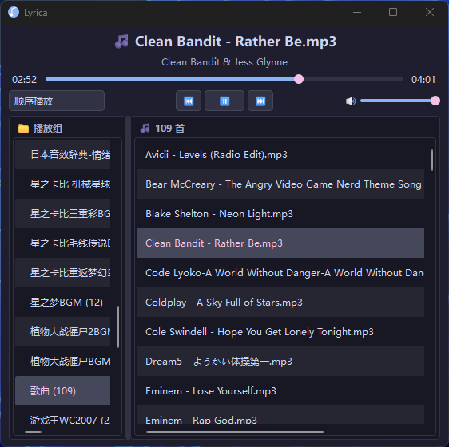

# 🎵 Lyrica
[](https://github.com/jackwolfey/lyrica/actions/workflows/ci.yml)

> **极简 · 纯本地 · 深色主题**的轻量级本地音乐播放器
> 专为极客与音乐爱好者打造

<p align="center">
  
</p>

## ✨ 核心特性

- 🎨 **现代深色 UI**：基于 Catppuccin Mocha 调色板，紧凑而不失优雅的界面设计。
- 🚀 **轻量且极速**：底层音频引擎基于 Rust 编写的 `miniaudio` (`just_playback`)，告别臃肿，秒级启动。
- 📁 **播放组管理**：以“文件夹”为单位的播放组概念，完美契合本地音乐播放需求（一个文件夹/专辑 = 一个播放组）。
- 🏷️ **智能元数据解析**：自动读取 ID3 标签（标题/艺术家/专辑），支持按文件名、标题、艺术家等多种方式排序。
- ⚡ **多线程无感扫描**：后台 `ScanWorker` 结合线程池，千首歌曲的文件夹添加也绝不让主线程卡顿。
- 💾 **无痕恢复**：自动记忆窗口大小、播放模式、音量、上次播放曲目及进度位置，重启即听。
- 🧪 **极致的可靠性**：**176 个单元测试，99% 覆盖率**，无缝接入 GitHub Actions CI。

## 📥 下载与安装

### 普通用户（推荐）
直接前往 [Releases](https://github.com/jackwolfey/lyrica/releases) 页面下载最新版的 `Lyrica.exe`（单文件，免安装，双击即用）。

### 开发者（源码运行）
确保你安装了 Python 3.8+，然后在终端执行：

```bash
# 1. 克隆仓库
git clone https://github.com/jackwolfey/lyrica.git
cd lyrica

# 2. 安装依赖
pip install -r requirements.txt

# 3. 运行
python main.py
```

## 🎮 使用说明

### 添加歌曲

Lyrica 以「文件夹 = 播放组」组织音乐，一个子文件夹就是一个播放组（专辑/歌手目录天然对应）。

**方式一：添加整个文件夹（推荐）**

1. 在左侧 **📁 播放组** 面板空白处 **右键 → 📁 添加文件夹…**
2. 选择音乐根目录，弹出「正在分析文件夹内容…」等待框
3. 后台 `ScanWorker` 递归扫描，每个**含音频文件的子文件夹**自动成为一个播放组，扫描期间可点「✕ 取消」
4. 扫描完成后左侧出现播放组列表，点击任一播放组，右侧即显示该组曲目

**方式二：添加单个/多个文件**

- 右键 **📁 播放组** 面板 → **📄 添加文件…**，多选音频文件；文件会按**所在目录**自动归入对应播放组（目录不存在则新建组）

支持的格式：`.mp3` `.wav` `.flac` `.ogg` `.m4a` `.aac` `.wma` `.opus`

> 重复添加同一文件夹是安全的：已收录的文件会自动去重，不会产生重复曲目。

### 播放与曲目管理

| 操作 | 方式 |
|------|------|
| 播放某首曲子 | **双击**右侧曲目，或右键曲目 → **▶️ 播放** |
| 上一曲 / 播放暂停 / 下一曲 | 底部 **⏮️ / ▶️ / ⏭️** 按钮 |
| 拖动进度 | 拖动进度条，松手即跳转 |
| 调节音量 | 拖动底部 🔊 右侧滑块 |
| 切换播放模式 | 左下角下拉框：**顺序播放 / 单曲循环 / 列表循环** |
| 曲目排序 | 右键曲目列表 → **🔀 排序方式** → 按文件名 / 曲目名称 / 艺术家 / 专辑 |
| 调整播放组顺序 | 右键左侧播放组 → **⬆ 上移 / ⬇ 下移 / 🔄 按默认顺序排序** |
| 移除播放组 | 右键左侧播放组 → **✕ 移除该播放组**（或 **🗑 清空所有播放组**） |

> 排序操作不会打断正在播放的曲目，也不会让视图跳走——播放中的那首歌会跟着移动，但界面仍停在你操作的那个播放组上。

### 最小化到系统托盘

Lyrica 默认**关闭**托盘驻留（点关闭即退出）。开启方式：

1. **右键顶部歌曲标题栏**（显示「🎵 歌曲名」的那一行）
2. 勾选 **「启用最小化到托盘」**

开启后：

- 点窗口的 **✕ 关闭** 或 **最小化按钮** → 窗口隐藏，任务栏图标消失，**托盘图标保留**，并弹出「已最小化到系统托盘」提示
- **左键单击托盘图标** → 恢复主窗口
- **右键托盘图标** → 显示主窗口 / ▶️ 播放暂停 / ⏭️ 下一曲 / ⏮️ 上一曲 / 退出

**想彻底退出？** 两种方式都会绕过托盘开关直接退出并保存状态：

- 右键标题栏 → **退出**
- 快捷键 **Ctrl + Q**

> 若运行环境没有系统托盘（部分 Linux 桌面 / 无桌面容器），该选项不起作用，关闭窗口会正常退出。

### 状态自动保存

以下内容在退出（或托盘退出）时自动写入 `lyrica_settings.json`，下次启动原样恢复：

- 窗口大小、播放组列表与顺序、当前选中组
- 播放模式、音量
- 上次播放的曲目 **及播放进度**（重启后停在原处，呈暂停状态，点 ▶️ 继续）
- 元数据缓存（重启后按「标题/艺术家」排序直接命中缓存，无需重新读标签）
- 最小化到托盘的开关状态

配置文件位置：打包版在 `Lyrica.exe` 同目录；源码运行在项目根目录。删除该文件即可恢复出厂设置。

### 关于对话框

右键顶部标题栏 → **关于 Lyrica...**，可查看当前版本号。

## 🛠️ 技术栈

- **UI 框架**: [PySide6](https://wiki.qt.io/Qt_for_Python) (Qt 6)
- **音频后端**: [just_playback](https://github.com/cheofusi/just_playback) (基于 Rust `miniaudio`)
- **元数据**: [tinytag](https://github.com/tinytag/tinytag)
- **打包**: PyInstaller (配置了极致的体积裁剪，避免打包上百MB的运行环境)

## 🧠 架构与性能亮点

Lyrica 在工程实现上做了一些“较真”的优化，以确保在管理数千首歌曲时依然流畅：

- **双向数据模型**：内部同时维护 `_groups`（UI 展示用的树状模型）和 `_playlist`（播放控制用的平铺列表）。播放控制时无需遍历树结构，切歌/循环逻辑 O(1) 级别。
- **增量并行扫描**：添加文件夹时，主线程不阻塞。`ScanWorker` 使用 `os.walk` 快速收集路径，已有缓存直接跳过，未缓存的使用 `ThreadPoolExecutor` 8 线程并行读取。
- **Metadata 冷热分离**：`meta_cache` 持久化到本地 JSON。重启后按“标题/艺术家”排序时直接命中热缓存，**1000 首歌排序从 3 秒缩短至 <10ms**。
- **UI 批量重绘渲染**：重写刷新逻辑，使用 `setUpdatesEnabled(False)` 冻结重绘并在底层批量 `addItems`，避免表格闪烁和 N 次 layout 计算。

## 🧪 测试与 CI (对无头环境友好)

本项目在 `tests/conftest.py` 中通过 `sys.modules` 注入了一个模拟的 `FakePlayback` 音频后端。
这意味着 **即使在完全没有声卡、没有显示器的 CI 容器中，也能完美运行所有的 UI 和播放逻辑测试**。

```bash
# 运行测试
pip install -r requirements-dev.txt
QT_QPA_PLATFORM=offscreen pytest

# 查看覆盖率
QT_QPA_PLATFORM=offscreen pytest --cov=src --cov=main
```

## 📦 自行打包

如果你修改了代码并希望自己打包成单文件 `.exe`：

```bash
pip install pyinstaller
pyinstaller Lyrica.spec --clean --noconfirm
# 产物位于 dist/Lyrica.exe，配置文件会自动生成在 exe 同级目录
```

## 🗺️ Roadmap (未来计划)

- [ ] LRC 歌词匹配与滚动显示
- [ ] 全局快捷键 (空格播放/暂停、方向键切歌)
- [ ] 拖拽本地音频文件直接播放
- [ ] 迁移到 `QAbstractListModel` (以支持单列表超 10000 首的极端场景)

## 📄 License

[MIT License](LICENSE) © 2026 jackwolfey

---
*“用代码写点自己真正会用的东西。”*